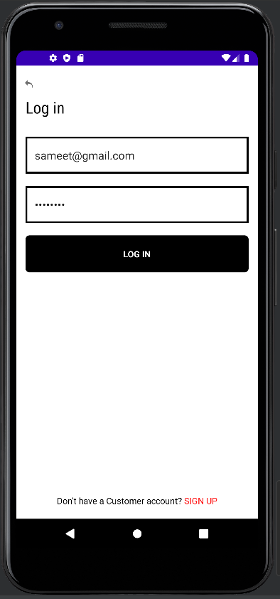
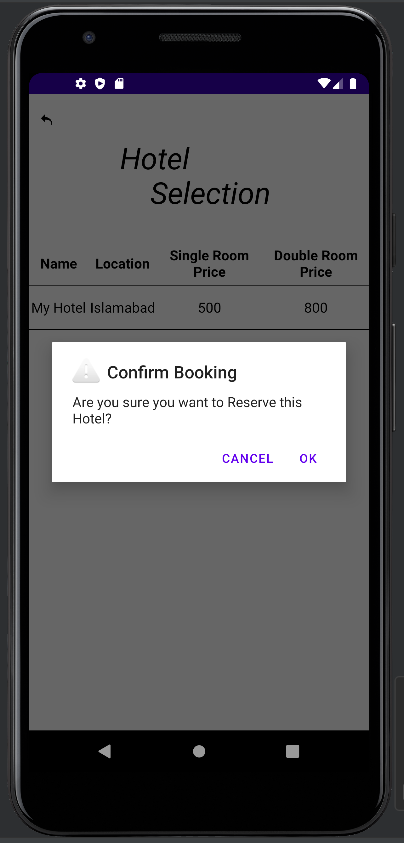
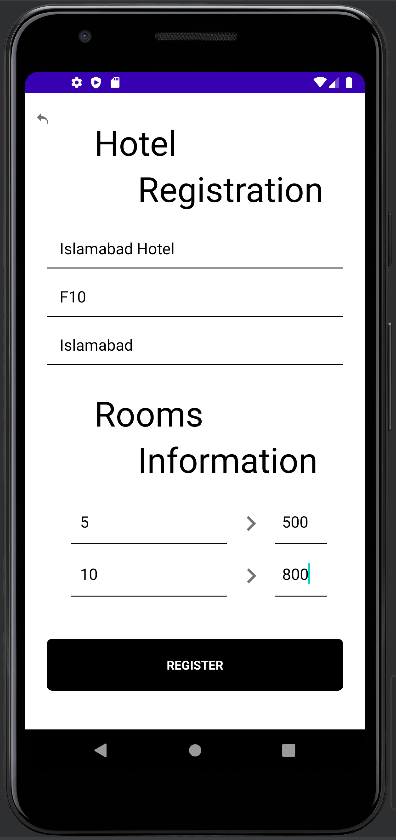
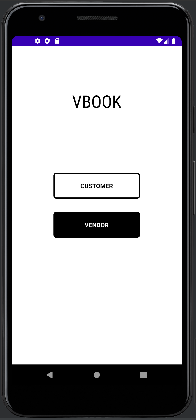
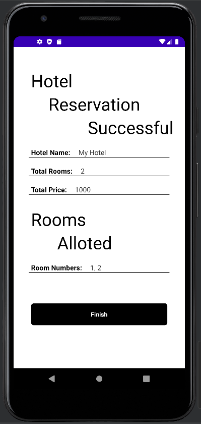
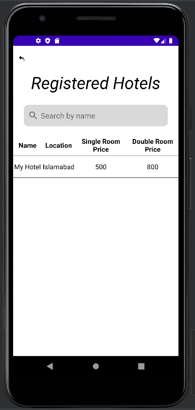

# VBook Android

An Android hotel marketplace backed by a PHP/MySQL API. VBook separates customer booking workflows from vendor inventory management in a single full-stack repository.


[](https://github.com/SameetAsadullah/vbook-android/actions/workflows/quality.yml)

## Capabilities

### Customers

- Create an account and sign in.
- Browse registered hotels and available rooms.
- Reserve rooms and review reservations.

### Vendors

- Create a vendor account and sign in.
- Register hotels and room inventory.
- Review listed properties and reservation activity.

## Repository layout

```text
api/       PHP endpoints for authentication, hotels, rooms, and reservations
mobile/    Complete Gradle Android project
docs/      Architecture and maintenance notes
extras/    Application and database screenshots
```

See [Architecture](docs/ARCHITECTURE.md) for the client/API responsibilities and data flow.

## Local setup

1. Install PHP, MySQL, and a local web server.
2. Create a MySQL database named `hotel_reservation_application` using the table structures shown in `extras`.
3. Serve the files in `api` from your web server.
4. Open `mobile` in Android Studio.
5. Set the development server address in `mobile/app/src/main/java/com/sameetasadullah/i180479_i180531/dataLayer/writerAndReader.java`.
6. Sync Gradle and run the application on an emulator or Android device.

The checked-in server address documents the original development environment. A deployed version should use build-time configuration and HTTPS.

## Screenshots

| Entry | Customer workflow | Vendor workflow |
| --- | --- | --- |
|  |  |  |
|  |  |  |

## Project status

This repository preserves the original Android and PHP implementation. Production deployment would require authenticated API sessions, prepared SQL statements, password hashing, HTTPS, environment-based configuration, and dependency upgrades.

## Contributors

- [Sameet Asadullah](https://github.com/SameetAsadullah)
- [Tayyab Ali](https://github.com/DarkDragz)

## License

Licensed under the [MIT License](LICENSE).
